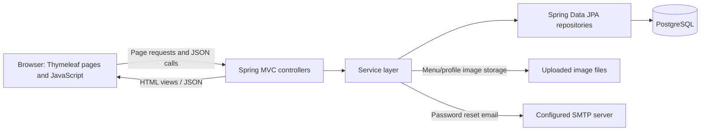
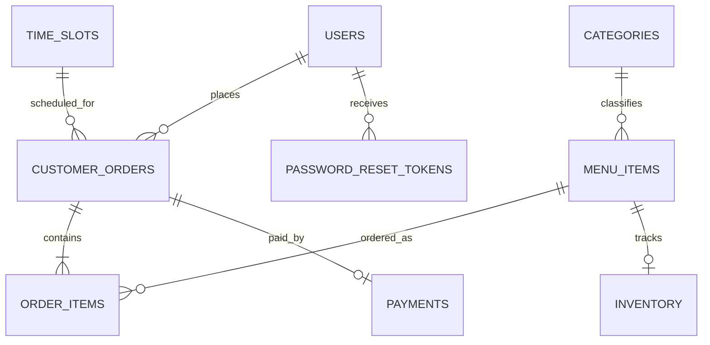
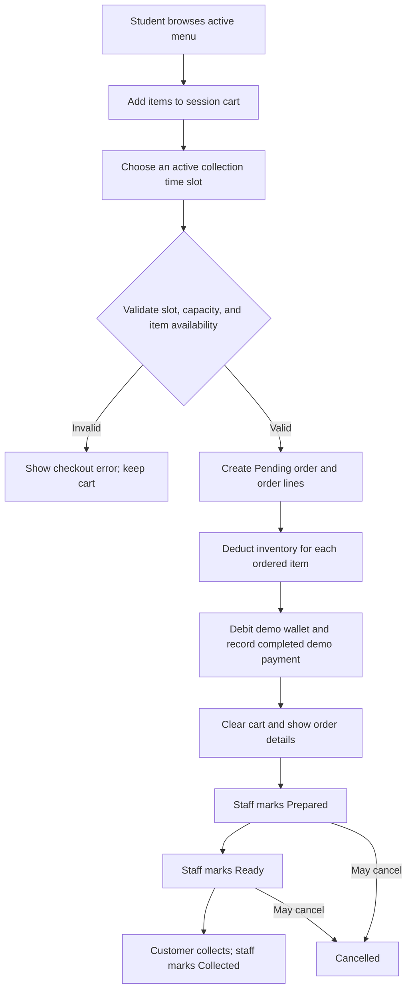

## Digital Campus Cafeteria Management System

A group project developed by Diploma in ICT: Applications Development students at the [Cape Peninsula University of Technology (CPUT)](https://www.cput.ac.za/).

This Spring Boot application supports advance cafeteria ordering by students and
provides staff and administrators with web tools for fulfilment and cafeteria
operations. It combines Thymeleaf-rendered pages with JSON endpoints used by
browser JavaScript.

> **Implementation note:** This README describes the source currently in this
> repository. Some domain components, such as inventory and payments, are
> intentionally demo-level or have no complete administration UI; these limits
> are called out below.

## Table of contents

- [Project overview](#project-overview)
- [Features and implementation status](#features-and-implementation-status)
- [Technology stack](#technology-stack)
- [Architecture](#architecture)
- [Project structure](#project-structure)
- [Database design](#database-design)
- [Roles and access control](#roles-and-access-control)
- [Order workflow](#order-workflow)
- [Routes and APIs](#routes-and-apis)
- [Installation and local setup](#installation-and-local-setup)
- [Configuration reference](#configuration-reference)
- [Testing and troubleshooting](#testing-and-troubleshooting)
- [Future improvements](#future-improvements)
- [Contributors](#contributors)

## Project overview

The Campus Cafeteria Management System is a web application for a campus
cafeteria. Students can browse the menu, maintain a session-based cart, choose a
collection time, and submit orders before visiting the cafeteria. Cafeteria
staff can review and fulfil orders and manage menu availability. Administrators
can also manage users, menu categories, and collection time slots.

The project was developed as a PRT262S Group 3 project. Its goal is to
demonstrate a digital ordering and operations workflow in place of relying
solely on in-person ordering and manual order coordination. The intended users
are:

- **Students**, who order food for collection and manage their account.
- **Staff**, who manage menu items and process customer orders.
- **Administrators**, who manage staff/student accounts and cafeteria
  configuration.

## Features and implementation status

### Student features

- Student registration and session-based login/logout.
- Password reset through an emailed, one-time verification code. Codes expire
  after 10 minutes.
- View active menu items, search the menu in the browser, and browse categories.
- Add items to a session cart, change quantities, remove individual items, or
  clear the cart.
- Submit an order with an active collection time slot.
- View personal order history and order details.
- View and update personal details, upload an optional profile picture, and
  delete the account.
- Use a demo wallet. New users receive a starting balance of R500; the profile
  page allows demo top-ups of R100, R250, or R500.

### Staff features

- Staff dashboard with order and menu summary metrics and recent orders.
- View incoming orders and customer/order details.
- Progress orders through their supported fulfilment statuses.
- Mark an item on an order as sold out.
- Add, edit, activate/deactivate, and change the availability status of menu
  items. Menu images can be uploaded when adding or editing an item.

### Administrator features

- Access to staff functions, plus a settings page.
- List and create users, change user roles (`STUDENT`, `STAFF`, `ADMIN`), and
  activate or deactivate accounts.
- Create, rename, and delete menu categories (deletion is prevented while a
  category is assigned to menu items).
- Create, edit, activate/deactivate, and delete collection time slots.
- Set a maximum order capacity for a time slot. The application rejects
  checkout when the number of existing orders for the slot reaches its
  configured capacity.

### Implemented components with limitations

- **Payments are simulated.** Checkout debits the application's demo wallet
  and records a completed `WALLET` payment with a demo reference. There is no
  external payment-provider integration.
- **Inventory is partly implemented.** The `Inventory` entity and service
  support stock deductions and restocking, and checkout deducts stock. Checkout
  therefore expects an inventory record for each ordered menu item. There is no
  staff-facing inventory management endpoint or screen in the current
  controllers.
- **Menu availability** uses the menu item's `Available`, `Low Stock`, and
  `Sold Out` statuses. Staff can set these directly; order placement also
  synchronizes status when inventory deductions are made.
- **Order notifications** are not implemented. Email is used for password
  reset, not order updates.
- The application has a staff dashboard with basic order and revenue metrics;
  it does not provide a dedicated sales-reporting module.

## Technology stack

| Technology | Use in this project |
|---|---|
| Java 17 | Application language and runtime baseline (`pom.xml`). |
| Spring Boot 3.5.16 | Application bootstrap and dependency management. |
| Spring MVC / Spring Web | Server-rendered page controllers and JSON endpoints. |
| Thymeleaf | Server-side HTML templates. |
| JavaScript, HTML, CSS | Browser interactions and page styling. |
| Bootstrap 5.3.3 and Bootstrap Icons 1.11.3 | UI layout and icons, loaded from jsDelivr CDN in `base.html`. |
| Spring Data JPA and Hibernate | Repository-based data access and ORM schema updates. |
| PostgreSQL | Relational application database; PostgreSQL JDBC driver is a runtime dependency. |
| Spring Security | Form/session authentication, role-based authorization, CSRF protection, and password encoding. |
| Spring Mail | Sends account password-reset codes over SMTP. |
| Maven | Build and dependency management; the project includes Maven wrapper scripts. |
| Spring Boot DevTools | Optional runtime development tooling. |
| Spring Boot Actuator | Actuator dependency is present; no custom actuator configuration is defined in this project. |

Passwords are encoded with BCrypt. Authentication uses a Spring Security
`UserDetailsService` backed by the `users` table. Most browser forms are
Thymeleaf templates, while some interactions call JSON endpoints using
`fetch`.

## Architecture

The application is a single Spring Boot web application. Controllers handle
HTTP requests and render Thymeleaf views or JSON responses. Services implement
business operations, repositories provide Spring Data JPA access, and Hibernate
maps model classes to PostgreSQL tables.



### Layer responsibilities

- **Controllers** (`controller/`) map page and API routes, validate request
  data, coordinate service calls, and select views or response bodies.
- **Services** (`service/`) contain operations such as checkout, order
  transitions, user management, menu/category management, and time-slot
  validation.
- **Repositories** (`repository/`) extend Spring Data repository interfaces for
  persistence and queries.
- **Models** (`model/`) are JPA entities and domain data classes.
- **Templates and static resources** (`resources/templates/` and
  `resources/static/`) provide the server-rendered UI, JavaScript, styles, and
  bundled imagery.

The foreign-key values in the entities are currently represented as scalar ID
fields (for example `CustomerOrder.userId`); there are no JPA
`@ManyToOne`/`@OneToMany` object mappings. The relationships in the diagram
below describe those logical ID references and database uniqueness constraints.

## Project structure

```text
.
├── pom.xml
├── mvnw / mvnw.cmd
├── src/
│   ├── main/
│   │   ├── java/com/group3/cafeteria_system/
│   │   │   ├── config/       # Security, password encoder, upload resources
│   │   │   ├── controller/   # MVC pages and JSON APIs
│   │   │   ├── model/        # JPA entities and domain models
│   │   │   ├── repository/   # Spring Data persistence interfaces
│   │   │   ├── service/      # Business logic and image storage
│   │   │   ├── CafeteriaSystemApplication.java
│   │   │   └── DataInitialiser.java
│   │   └── resources/
│   │       ├── application.properties
│   │       ├── static/
│   │       │   ├── css/
│   │       │   ├── images/
│   │       │   └── videos/
│   │       └── templates/
│   │           ├── customer/
│   │           └── staff/
│   └── test/java/com/group3/cafeteria_system/
└── README.md
```

Important source areas:

- `controller/AuthController.java`: registration, authentication-related
  pages/APIs, and password-reset flows.
- `controller/CustomerController.java` and `PageController.java`: customer
  pages, profile, checkout, and order views.
- `controller/CartApiController.java` and `MenuApiController.java`: cart and
  public menu/category/time-slot JSON endpoints.
- `controller/StaffController.java`: staff operations and admin-only
  configuration APIs.
- `service/CheckoutService.java`, `OrderService.java`, and `WalletService.java`:
  checkout, order lifecycle, and demo wallet handling.
- `config/SecurityConfig.java`: route authorization, form login/logout, CSRF,
  and access-denied handling.
- `config/AccountStatusFilter.java`: invalidates sessions if the user's
  account is no longer active or the user's role has changed.
- `resources/application.properties`: database, SMTP, Hibernate, server,
  upload, and multipart settings.
- Uploaded images are stored outside `src/main/resources` in the configured
  upload directory (default `uploads/`).

## Database design

The configured database is PostgreSQL, with the default JDBC URL
`jdbc:postgresql://localhost:5432/cafeteria_db`. Hibernate uses
`spring.jpa.hibernate.ddl-auto=update` to update the schema at application
startup. The repository does not include a migration system or a separate SQL
schema file.

### Main entities

| Entity/table | Responsibility |
|---|---|
| `User` / `users` | Student, staff, and admin accounts; role, account status, wallet balance, and optional profile-picture URL. |
| `Category` / `categories` | Unique menu category names. |
| `MenuItem` / `menu_items` | Menu item details, category ID, price, availability status, active flag, and optional image URL. |
| `CustomerOrder` / `customer_orders` | Order owner ID, collection-slot ID, total, status, and timestamp. |
| `OrderItem` / `order_items` | Menu item ID, quantity, and unit price captured when the order was placed. |
| `TimeSlot` / `time_slots` | Collection time, active flag, and maximum order count. |
| `Inventory` / `inventory` | Stock quantity, reorder level, and unit for a menu item; `menu_item_id` is unique. |
| `Payment` / `payments` | Payment amount, method, status, reference, and date; `order_id` is unique. |
| `PasswordResetToken` / `password_reset_tokens` | One-time reset code, associated user ID, expiry, and used flag. |

### Logical entity relationships



The order header and its lines are stored separately. `order_items.unit_price`
preserves the price at order time, and each line subtotal is calculated from
that stored price and quantity. `customer_orders.order_status` starts as
`Pending`. Users are assigned roles using a string field rather than a separate
roles table.

## Roles and access control

Registration creates `STUDENT` accounts. The admin user-management endpoints
can create accounts and assign `STUDENT`, `STAFF`, or `ADMIN` roles.

| Role | Implemented access |
|---|---|
| `STUDENT` | Customer menu and cart pages/APIs, checkout, order history/details, and profile functions. |
| `STAFF` | Staff dashboard, order management, and menu management. |
| `ADMIN` | Staff functionality plus user management, category management, time-slot management, and `/staff/settings`. |
| Unauthenticated | Landing and authentication pages, static resources, uploaded images, and read-only menu/category/time-slot APIs. |

Spring Security uses session-based form authentication. Passwords are BCrypt
encoded, CSRF protection is enabled for state-changing requests, and an account
status filter invalidates authenticated sessions when access becomes inactive
or the assigned role changes. The route configuration explicitly restricts
customer routes to `STUDENT`, admin settings APIs to `ADMIN`, and general staff
routes to `STAFF` or `ADMIN`.

## Order workflow



The checkout operation validates that the cart is not empty, the chosen time
slot is active and below capacity, and each menu item is available. It then
creates an order in `Pending`, saves its line items, deducts inventory, debits
the student's wallet, and records a completed demo payment. These operations
are coordinated by the transactional checkout service.

Staff can move an order through these transitions:

| Status | Meaning |
|---|---|
| `Pending` | Order has been placed and awaits staff preparation. |
| `Prepared` | Staff has prepared the order. |
| `Ready` | Order is ready for collection. |
| `Collected` | Order has been collected; it cannot be advanced further. |
| `Cancelled` | Order has been cancelled from an eligible earlier status. |

Supported forward transitions are `Pending → Prepared → Ready → Collected`.
Orders may be cancelled from `Pending`, `Prepared`, or `Ready`. No live/push
notification is sent when a status changes.

## Routes and APIs

The application is primarily a server-rendered MVC application with JSON
endpoints for browser interactions and integrations. The tables below list the
main routes implemented by the controllers; they are not an exhaustive
description of every request parameter or response field.

### Pages and account flows

| Method | Endpoint | Purpose | Access |
|---|---|---|---|
| `GET` | `/` | Landing page. | Public |
| `GET` | `/login` | Login page. | Public |
| `POST` | `/login` | Spring Security form login. | Public |
| `GET`, `POST` | `/register` | Student registration page and form submission. | Public |
| `GET`, `POST` | `/forgot-password` | Request password reset. | Public |
| `GET`, `POST` | `/verify-reset-code` | Verify reset code. | Public |
| `GET`, `POST` | `/reset-password` | Set a new password after verification. | Public |
| `POST` | `/logout` | End the authenticated web session. | Authenticated |
| `GET` | `/menu` | Customer menu page; supports `?categoryId=`. | `STUDENT` |
| `GET` | `/cart`, `/confirmation` | Cart and checkout confirmation pages. | `STUDENT` |
| `POST` | `/checkout` | Submit an order with a `timeSlotId`. | `STUDENT` |
| `GET` | `/customer/history`, `/orders` | View customer order history (`/orders` redirects). | `STUDENT` |
| `GET` | `/orders/{id}` | View an order's details. | `STUDENT` (as enforced by route security) |
| `GET`, `POST` | `/profile` | View and update profile, including optional picture upload. | Authenticated |
| `POST` | `/profile/wallet/top-up` | Add one of the supported demo credit amounts. | Authenticated |
| `POST` | `/profile/delete-account` | Delete the current account and log out. | Authenticated |

### JSON APIs

| Method | Endpoint | Purpose | Access |
|---|---|---|---|
| `POST` | `/api/auth/login` | Authenticate and create a session. | Public |
| `POST` | `/api/auth/logout` | Clear the API caller's session. | Public route; requires an existing session to log out |
| `POST` | `/api/auth/register` | Register a `STUDENT` account. | Public |
| `POST` | `/api/auth/forgot-password` | Request a reset code by email. | Public |
| `POST` | `/api/auth/reset-password` | Reset password with a valid code. | Public |
| `GET` | `/api/menu`, `/api/menu/{id}` | Read active menu items or one menu item. | Public |
| `GET` | `/api/categories`, `/api/time-slots` | Read categories and active collection slots. | Public |
| `GET` | `/api/cart` | Read the current session cart. | `STUDENT` |
| `POST` | `/api/cart/items` | Add an item to the session cart. | `STUDENT` |
| `PUT`, `DELETE` | `/api/cart/items/{menuItemId}` | Update or remove one cart line. | `STUDENT` |
| `DELETE` | `/api/cart` | Clear the session cart. | `STUDENT` |
| `GET` | `/api/staff/dashboard/stats`, `/api/staff/orders` | Read staff dashboard metrics or orders. | `STAFF`, `ADMIN` |
| `PATCH` | `/api/staff/orders/{id}/status` | Change an order's status. | `STAFF`, `ADMIN` |
| `PATCH` | `/api/staff/orders/{orderId}/items/{menuItemId}/out-of-stock` | Mark an ordered menu item sold out. | `STAFF`, `ADMIN` |
| `POST` | `/api/staff/menu` | Create a menu item (JSON or multipart form; multipart supports image upload). | `STAFF`, `ADMIN` |
| `PUT`, `POST` | `/api/staff/menu/{id}` | Update a menu item (JSON `PUT` or multipart `POST`; multipart supports image replacement). | `STAFF`, `ADMIN` |
| `PATCH` | `/api/staff/menu/{id}/status`, `/api/staff/menu/{id}/activate`, `/api/staff/menu/{id}/remove` | Change status or activate/deactivate a menu item. | `STAFF`, `ADMIN` |
| `POST`, `PUT`, `DELETE` | `/api/staff/categories...` | Create, rename, or delete menu categories. | `ADMIN` |
| `POST`, `PUT`, `PATCH`, `DELETE` | `/api/staff/time-slots...` | Manage collection slots, capacity, and activation. | `ADMIN` |
| `GET`, `POST`, `PATCH` | `/api/staff/users...` | List/create users and update roles/account statuses. | `ADMIN` |

Spring Security's configured custom access-denied handler returns JSON
`401`/`403` responses for restricted API requests.

## Installation and local setup

### Prerequisites

- Java Development Kit (JDK) 17.
- PostgreSQL server, with a database user allowed to create/use the application
  database.
- Git.
- Maven is optional when using the included Maven wrapper (`mvnw` or
  `mvnw.cmd`).
- An SMTP account/configuration for password-reset email. The checked-in
  configuration is set up for Gmail SMTP.
- An IDE such as IntelliJ IDEA, Eclipse, or VS Code is optional.

### Clone the repository

```bash
git clone https://github.com/Group3-CPUT-PRT262s/cafeteria-system.git
cd cafeteria-system
```

### Create the PostgreSQL database

The configured default database is `cafeteria_db` on `localhost:5432`.
Create it using PostgreSQL, for example:

```sql
CREATE DATABASE cafeteria_db;
```

Or from a shell with PostgreSQL tools installed:

```bash
createdb -U postgres cafeteria_db
```

The application uses Hibernate's `ddl-auto=update` setting to create/update
tables on startup. It does not use a Flyway/Liquibase migration or seed SQL
file. Keep a backup before using this setting with data that matters.

### Configure required values

The application reads credentials from environment variables. Set them in the
same terminal used to start the app (do not commit real credentials):

```bash
export DB_USERNAME="postgres"
export DB_PASSWORD="your-local-postgres-password"
export MAIL_USERNAME="your-smtp-account@example.com"
export MAIL_APP_PASSWORD="your-smtp-app-password"
```

`MAIL_APP_PASSWORD` is the SMTP application password configured for the Gmail
account; it is not the Gmail account's ordinary login password. Password-reset
email will not work until SMTP credentials are valid. The required mail
properties are resolved during application startup, so configure them even if
you do not plan to test password reset.

On Windows PowerShell, use:

```powershell
$env:DB_USERNAME = "postgres"
$env:DB_PASSWORD = "your-local-postgres-password"
$env:MAIL_USERNAME = "your-smtp-account@example.com"
$env:MAIL_APP_PASSWORD = "your-smtp-app-password"
```

### Build, test, and run

Linux/macOS:

```bash
./mvnw test
./mvnw spring-boot:run
```

Windows:

```bat
mvnw.cmd test
mvnw.cmd spring-boot:run
```

If Maven is installed separately, `mvn test` and `mvn spring-boot:run` are
equivalent alternatives.

The application is configured for port **8080**. Open
<http://localhost:8080/> or go directly to <http://localhost:8080/login>.
Registration is available at `/register`; the student menu is at `/menu`; staff
users can use `/staff/dashboard`.

On the first startup against a database without an `admin` user, the
`DataInitialiser` creates an `ADMIN` account with username `admin` and a
randomly generated password printed to the application console. Use that
generated password for the initial login and change it immediately. This
initializer does not create menu categories, menu items, or inventory records.

## Configuration reference

| Setting | Source/default | Purpose |
|---|---|---|
| `spring.datasource.url` | `jdbc:postgresql://localhost:5432/cafeteria_db` | PostgreSQL server, port, and database. |
| `spring.datasource.username` | `DB_USERNAME` (defaults to `postgres`) | PostgreSQL login. |
| `spring.datasource.password` | `DB_PASSWORD` | PostgreSQL password. |
| `spring.mail.host` | `smtp.gmail.com` | SMTP server for password reset. |
| `spring.mail.port` | `587` | SMTP submission port with STARTTLS. |
| `spring.mail.username` | `MAIL_USERNAME` | SMTP sender account. |
| `spring.mail.password` | `MAIL_APP_PASSWORD` | SMTP app password. |
| `server.port` | `8080` | HTTP port. |
| `spring.jpa.hibernate.ddl-auto` | `update` | Update the schema at startup. |
| `spring.jpa.show-sql` | `true` | Log generated SQL statements. |
| `app.upload-dir` | `UPLOAD_DIR`, default `uploads` | Filesystem directory for menu and profile images. |
| `spring.servlet.multipart.max-file-size` | `5MB` | Maximum uploaded file size. |
| `spring.servlet.multipart.max-request-size` | `6MB` | Maximum multipart request size. |

The upload directory is resolved relative to the process working directory
unless `UPLOAD_DIR` is absolute. Uploaded files are served under `/uploads/`;
the database stores their URL paths. The current image upload service accepts
JPEG, PNG, and GIF files and validates decoded image content and dimensions.

The project uses `application.properties` rather than an auto-loaded `.env`
file. Use environment variables or an uncommitted local Spring configuration
to provide secrets. Never put real passwords in source control.

## Testing and troubleshooting

### Available tests

The repository includes:

- `CafeteriaSystemApplicationTests`
- `AuthControllerTest`
- `CategoryServiceTest`
- `TimeSlotServiceTest`
- `UserServiceTest`
- `WalletServiceTest`

Run the test suite with `./mvnw test` (or `mvnw.cmd test` on Windows). This
README update does not claim that the tests were executed.

### Common issues

| Symptom | Checks |
|---|---|
| Application fails to connect to PostgreSQL | Confirm PostgreSQL is running, `cafeteria_db` exists, the server listens on the configured host/port, and `DB_USERNAME`/`DB_PASSWORD` are correct. |
| Startup reports unresolved datasource or mail properties | Set `DB_PASSWORD`, `MAIL_USERNAME`, and `MAIL_APP_PASSWORD`; the username defaults to `postgres` if `DB_USERNAME` is omitted. |
| Password reset email is not delivered | Check Gmail SMTP access, port 587/STARTTLS, sender account, and app password. Check application logs for mail errors. |
| A user is redirected to login or receives API `401`/`403` | Confirm that the account is `ACTIVE`, sign in again after role/status changes, and use an account with the role required by the route. |
| Checkout fails during stock deduction | Ensure each ordered menu item has an `inventory` record; the startup initializer does not seed inventory. |
| Uploaded image URL returns `404` | Confirm the upload directory is writable and persistent, that `UPLOAD_DIR` is consistent between runs, and that the stored file still exists. |
| Port 8080 is already occupied | Stop the other process using the port or change `server.port` in local configuration. |

## Future improvements

These are possible enhancements, not claims about existing functionality:

- Integrate a real online payment provider rather than the demo wallet.
- Add order email/SMS notifications and live customer status updates.
- Add an administrator/staff inventory interface for recording stock and
  restocking.
- Expand the dashboard into sales and operational reporting.
- Add customer feedback and menu-item ratings.
- Adopt versioned database migrations and environment-specific production
  configuration.
- Deploy uploaded images to managed object storage for multi-instance hosting.

## Contributors

The project is identified in the repository as **PRT262S Group 3**. The Git
commit history contains commits authored under the names **Tando Njikelana**
and **ZarahMu**. The repository does not document individual role assignments,
so no per-person responsibilities are inferred here.
